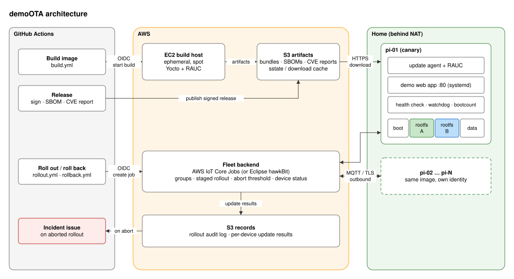

# demoOTA

Demonstrate Over-The-Air (OTA) updates on real hardware: a Raspberry Pi 4 on the desk
(extendable to a small fleet of Pis), an embedded Linux image built in AWS, and update
rollouts, rollbacks and failure recovery driven entirely from GitHub Actions.

> Status: planning. Device side decided (Yocto + RAUC); fleet backend still to be
> decided. The roadmap is below; work will be tracked as GitHub issues.

## Goal

Show how a device fleet is updated safely, the way it is done in production:

- a reproducible Linux image for the Raspberry Pi 4, built in CI in the cloud
- signed update bundles, installed into an inactive **A/B slot** and activated by an
  atomic switch
- a regular update, a **manual rollback**, and an **automatic rollback** when a new
  image does not boot
- **fleet** handling: device groups, staged (canary) rollouts, per-device status, and a
  rollout that stops itself when updates fail

## Architecture



*Source: [docs/architecture.drawio.svg](docs/architecture.drawio.svg) is an editable
draw.io diagram. To edit it in VS Code or Cursor, install the "Draw.io Integration" extension
(`hediet.vscode-drawio`, on the VS Code Marketplace and Open VSX), or open the file at
[app.diagrams.net](https://app.diagrams.net).*

The system has three parts: **GitHub Actions** drives everything, **AWS** builds and
stores images and coordinates the fleet, and the **Raspberry Pis at home** install
updates.

1. The *build* workflow authenticates to AWS with GitHub OIDC and starts an ephemeral
   EC2 build host. The host builds the Yocto image and the RAUC bundle and writes the
   artifacts (bundle, SBOM, CVE report) to S3. The Yocto download and sstate caches
   are also kept in S3.
2. The *release* workflow publishes a signed release (bundle, SBOM, CVE report) from S3.
3. The *rollout* or *rollback* workflow creates a job in the fleet backend for a device
   group, for example the canary first, then the rest.
4. Each Pi keeps an outbound MQTT/TLS connection to the fleet backend. When it gets a
   job, it downloads the bundle from S3 over HTTPS and installs it into the inactive
   rootfs slot with RAUC, then reboots into it.
5. On the device, a health check, the hardware watchdog and boot counting decide
   whether the new slot is kept or the device falls back to the previous slot.
6. Devices report the update result to the fleet backend, which stores it in the S3
   audit log and per-device records. If a rollout is aborted, a workflow opens an
   incident issue in GitHub.

Details:
- **Build host:** Yocto needs more CPU and disk than GitHub-hosted runners provide, so
  each build starts an ephemeral EC2 instance (spot) that is terminated afterwards. The
  download and shared-state (sstate) caches are kept in S3, so rebuilds are fast.
- **Artifacts:** RAUC bundles, signed in CI, stored in S3. Devices download them over
  HTTPS with pre-signed URLs.
- **Devices:** one or more Raspberry Pi 4s at home. Each device connects only outward
  to the fleet backend (TLS, a certificate per device), so no port forwarding is needed.
- **Fleet backend:** tells devices what to install, rolls out in groups, and collects
  results. The options are described below.
- **Everything through GitHub Actions:** build, sign, publish, roll out and roll back
  are all workflows. CI reaches AWS through GitHub OIDC (no long-lived keys). The
  one-time AWS bootstrap is applied by hand ([infra/bootstrap](infra/bootstrap/README.md)).

### Device image

Built with **Yocto** (`meta-raspberrypi`) and updated with **RAUC**
(`meta-rauc-community`). This is the industry-standard embedded Linux stack: full
control of the image, signed bundles, A/B slots and boot counting, and RAUC works with
any of the fleet backends below.

| Partition | Content |
|---|---|
| boot | firmware, bootloader, boot-slot selection |
| rootfs A | one image slot (read-only) |
| rootfs B | the other image slot (read-only) |
| data | persistent: device identity, app data, logs |

- An update is written to the inactive slot, then the device reboots into it.
- **Boot counting + hardware watchdog:** a new slot gets a limited number of boot
  attempts. Only after a health check passes (the app service is up and the device has
  reached the cloud) is the slot marked good. Otherwise the bootloader falls back to the
  previous slot, on the device itself, without the cloud.
- **Demo web app:** a small service started by systemd. It shows the image colour,
  version, active slot and uptime. Its exact form is still to be defined.

### Fleet

The design supports 1..N Raspberry Pi 4 targets, starting with the one on the desk.

- **One image for every device.** Nothing device-specific is built in. Each device's
  identity (device ID, X.509 certificate) is provisioned into the data partition after
  flashing.
- **Groups and staged rollouts:** a canary group gets an update first, then the rest of
  the fleet.
- **Per-device status:** current version, active slot, last update result.
- **Rollout safety:** if updates fail beyond a threshold, the rollout is aborted
  before it reaches the rest of the fleet.
- *Optional:* virtual devices (the same stack built for QEMU arm64, run on ephemeral
  EC2) to make the fleet bigger without more hardware.

### Fleet backend (to be decided)

| Option | Pros | Cons |
|---|---|---|
| **AWS IoT Core Jobs** (recommended) | serverless, pay per use; thing groups; rollout rate and abort-on-failure settings; device shadow for status | a small agent on the device runs `rauc install` and reports the result |
| Eclipse hawkBit | open source, built for fleets, web UI, rollout groups with error thresholds, a ready-made RAUC client | a Java server to host (an EC2 instance started for each demo) |

## OTA scenarios

| Image | Purpose |
|---|---|
| **green** | default image, flashed once to the SD card |
| **blue** | a regular, working update |
| **red** | deliberately broken: fails to boot or never passes the health check |

| Scenario | Steps | Expected result |
|---|---|---|
| Regular update | roll out blue to a device running green | device installs into the other slot, reboots, the app shows **blue** |
| Manual rollback | trigger the rollback workflow | device switches back to the previous slot, the app shows **green** |
| Automatic rollback | roll out red to a device running green or blue | boot fails, attempts run out or the watchdog fires; the device falls back to the image it ran before and reports a failed update |
| Staged fleet rollout | roll out blue: canary group first, then everyone | the fleet moves to blue group by group; status is visible per device |
| Fleet rollout aborted | roll out red, canary first | the canary rolls back automatically, the failure threshold is passed, the rollout stops; the rest of the fleet stays untouched; an incident issue is opened |

## Compliance and traceability

This demo is not a product placed on the market, so no regulation applies to it
legally. It still produces the evidence a real product would need, following the EU
Cyber Resilience Act (CRA), with notes on UN R156 / ISO 24089 (software updates in
vehicles) and NIS2 (operators of essential services).

| Evidence | How the demo produces it |
|---|---|
| SBOM for every release | Yocto `create-spdx` (SPDX), published with the bundle |
| Known vulnerabilities | Yocto CVE check report for each build |
| Integrity / provenance | signed RAUC bundle; hash and git commit in the release metadata |
| Release record | GitHub release: version, changelog, SBOM, whether it is a security fix |
| Rollout audit log | who started or approved the rollout, target group, timestamps |
| Per-device update record | device, from/to version, slot, result (success / rolled back / failed), stored in S3 |
| Failed-update incident record | an aborted rollout opens a GitHub issue automatically, with the per-device results and logs, a postmortem template, and a check whether the failure has a security impact (that would make it reportable under the CRA) |

## Cost model

The cloud side is pay-per-use. Build instances exist only while a build runs. S3 holds
a few GB of bundles and caches. AWS IoT Core costs cents per month for a few devices.
If hawkBit is chosen, it runs only during a demo. The Pis are the only always-on
devices.

## Roadmap

| Phase | Content |
|---|---|
| 0. Foundation | AWS bootstrap (Terraform state, GitHub OIDC, IAM roles, S3 buckets), signing keys |
| 1. Image build | Yocto + RAUC for Pi 4 on ephemeral EC2 in CI, green/blue/red variants, demo web app, SBOM and CVE report |
| 2. Device update | A/B partition layout, RAUC, boot counting, watchdog, health check |
| 3. Fleet backend | choose the backend, device provisioning, rollout and rollback workflows, fleet status |
| 4. Scenarios | regular update, manual rollback, automatic rollback |
| 5. Fleet scenarios | staged rollout, aborted rollout, second Pi (optional: QEMU virtual devices), audit log, incident record on aborted rollout |

## Repository layout (planned)

```
infra/       Terraform: AWS bootstrap, build host, fleet backend
yocto/       Yocto layers, machine/distro config, image recipes (green, blue, red)
app/         demo web application
fleet/       device provisioning, rollout and rollback helpers
scenarios/   one directory per demo scenario: runbook + script
scripts/     helpers called by the Makefile
```

## Related repositories

- [bootstrapRPI4](https://github.com/CloudConsultancies/bootstrapRPI4): a Raspberry
  Pi OS image for the same Pi, built with pi-gen
- [demoEmbeddedLinuxBuild](https://github.com/CloudConsultancies/demoEmbeddedLinuxBuild):
  a Buildroot image built in CI and deployed to GCE

## How we work

Work is planned as GitHub issues (templates: task, bug, demo scenario) and implemented on
`issue/N-short-name` branches, one pull request per issue. See
[.claude/CLAUDE.md](.claude/CLAUDE.md) for the full workflow and conventions.
